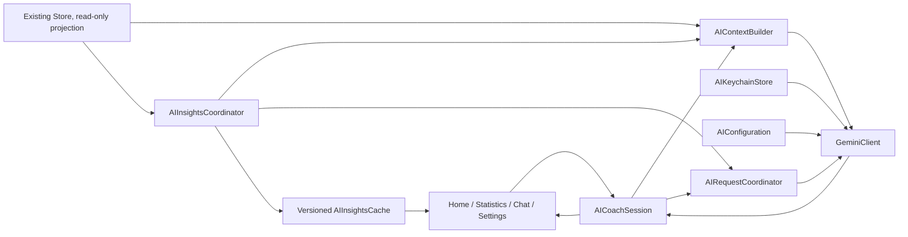
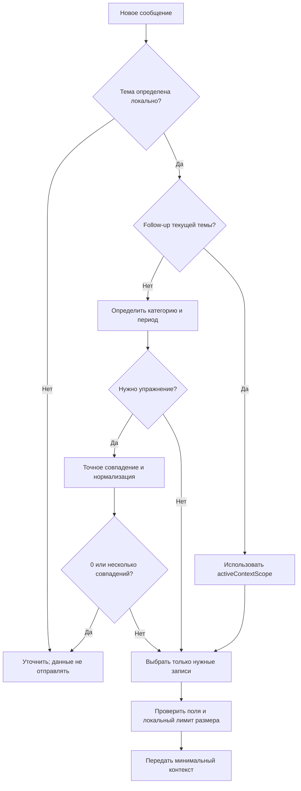
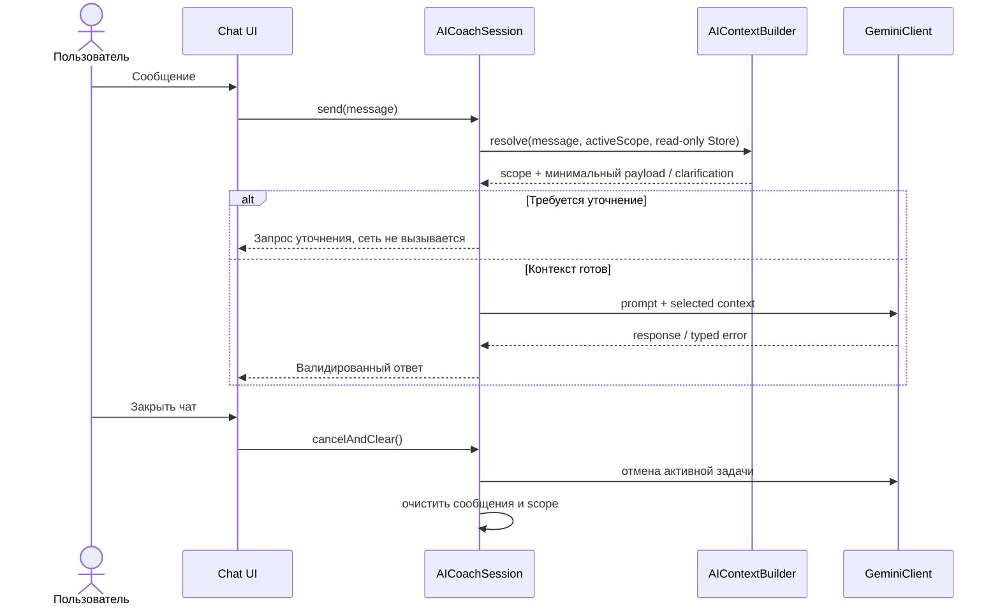
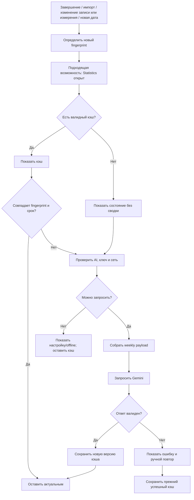

# AI Coach — архитектура

**Статус:** предлагаемая интеграция. Всё в разделах «Текущее состояние» подтверждено репозиторием; AI-компоненты ниже пока не существуют.

## Текущее состояние приложения

### Исходники, модели и Store

Исходный код приложения пока собран в `GymForTeenage/GymForTeenageApp.swift`; слой оформления разделён на `PremiumDesign.swift` и `PremiumViews.swift`. `GymForTeenageApp` создаёт `Store` и передаёт его через SwiftUI environment. `Store` — `@MainActor @Observable`; модели `SetLog`, `ExerciseLog`, `Session`, `Record`, `Measure`, `WaterDay`, `Backup` реализуют Codable. `Catalog` содержит 15 упражнений и три статических шаблона тренировок.

Store хранит записи, измерения, воду, одну активную сессию, пользовательские инструкции, настройки уведомлений и журнал креатина. `current(_:)` создаёт сессию из шаблона или возвращает уже активную; `mutate(_:)` сохраняет изменения. `finish()` вставляет снимок сессии в начало `records`, обнуляет `session` и сохраняет. История упражнения выбирает записи по `exerciseID` или `actualID`, исключает пропуски и сортирует по дате. `Metrics` считает тоннаж выполненных непустых подходов.

### Хранение, backup и очистка

`Store` читает/пишет `gym-data.json` в Application Support через Codable и атомарную запись. Некорректное существующее хранилище блокирует автоматическую перезапись. `Backup` версии 1 включает записи, измерения, воду, сессию, инструкции, напоминания и креатин. `restore(_:)` ограничивает входной файл 20 MiB, декодирует и проверяет структуру, атомарно записывает проверенный документ и только затем меняет состояние Store. `export()` пишет временный JSON. Ключ AI и чат нельзя добавлять в этот DTO.

`clear()` обнуляет пользовательские данные и снимает pending local notifications; статический каталог не удаляется. При интеграции следует отдельно решить, очищает ли эта операция API-ключ и AI-кэш; продуктово ожидается удаление Insights-кэша и active AI state. Ключ предпочтительно оставить настройкой подключения, пока пользователь не выбрал удалить его, чтобы очистка тренировочной базы не стирала секрет неожиданно.

Импорт другого backup заменяет входной набор данных и должен инвалидировать/пересчитать AI-кэш после успешного `restore(_:)`, не до него. Текущий Store не имеет отдельного API удаления или редактирования завершённой тренировки; это описание будущей координации, а не утверждение о существующем методе. Любой будущий путь, изменяющий/удаляющий `Record`, измерения или иной вклад в Insights, должен пересчитать fingerprint. Изменение локальной календарной даты или timezone также перепроверяет временное окно. Не добавлять поля AI в `Backup`.

### UI, проект и CI

В `PremiumViews.swift` уже реализован интерфейс, а не только проектная спецификация: `PremiumRootView` — существующие четыре назначения Home, Progress, Statistics, Settings; присутствуют карточки, измерения, тренировки, вода, аналитические графики и настройки. Токены/компоненты находятся в `PremiumDesign.swift`; палитра включает ink/surface, lime, violet и ice. AI следует встроить в эти текущие экраны и стиль.

`GymForTeenage.xcodeproj/project.pbxproj`: два targets (app и unit-test bundle), deployment iOS 17.0, Swift 5.0, Xcode project format objectVersion 56. App target явно включает исходники и системные ресурсы; добавление Swift-файлов потребует явной записи в project file. Подключены SwiftUI/Charts/UserNotifications/UniformTypeIdentifiers/UIKit/Observation в существующем исходнике; внешних пакетов нет.

Тесты: `MetricsTests.swift` проверяет тоннаж/подходы и расписание напоминаний; `StoreIntegrationTests.swift` — файл-перезапуск, восстановление сессии, измерения/вода, невалидный импорт без замены, импорт-замещение, очистку, повреждённое хранилище, пропуски и креатин. Существующие assertions сохраняются.

`.github/workflows/ios.yml` запускается на push, pull request и вручную на `macos-15`; проверяет проект, выполняет XCTest и `xcodebuild analyze`, архивирует без signing, упаковывает unsigned IPA, валидирует его скриптом и загружает artifact. Этот workflow обязателен к изучению перед любыми будущими изменениями CI. Локальная Windows-сборка Xcode недоступна.

## Проверенная конфигурация Gemini

Официальная документация Google на 13 ноября 2026 подтверждает стабильный ID `gemini-3.1-flash-lite`; поддерживаются `generateContent` и structured outputs. Официальная карточка модели указывает входной лимит 1,048,576 токенов и выходной 65,536, но приложение должно задавать значительно меньший собственный лимит контекста для приватности и стоимости. Preview ID `gemini-3.1-flash-lite-preview` закрыт 25 мая 2026; не использовать его. Дата раннего возможного shutdown стабильной версии — 7 мая 2027, поэтому модель конфигурируется централизованно и регулярно перепроверяется. [Карточка модели](https://ai.google.dev/gemini-api/docs/models/gemini-3.1-flash-lite), [structured outputs](https://ai.google.dev/gemini-api/docs/structured-output?lang=rest), [deprecations](https://ai.google.dev/gemini-api/docs/deprecations).

REST `generateContent` остаётся поддерживаемым официальным API и подходит заданному простому клиентскому транспорту. Аутентификация — заголовок `x-goog-api-key`; не передавать ключ в URL. Указывать endpoint/параметры конфигурацией. Grounding отключить. Структурированный JSON-ответ декодировать Codable, валидировать смысл и ссылки на предоставленные факты. Лимиты и квоты аккаунта не фиксировать как гарантированные.

## Предлагаемое минимальное разделение

Сохранить Store источником пользовательской истины; не добавлять в него сеть, ключи или AI-логику. Минимальный набор:

1. `AIConfiguration` — модель ID, endpoint, таймауты, пределы, generation settings, system instruction.
2. `AIKeychainStore` — CRUD ключа и проверка статуса; интерфейс для подмены в тестах.
3. `GeminiClient` — URLSession, Codable REST DTO, HTTP/JSON mapping, cancellation и ограниченный retry.
4. `AIContextBuilder` — локальная классификация/разрешение scope и проекция Store в минимальный Codable payload.
5. `AICoachSession` — временные сообщения, activeContextScope, pending task и очистка; один общий менеджер с режимами chat/insights либо небольшие менеджеры, если UI state станет труден для сопровождения.
6. `AIInsightsCache` и `AIInsightsCoordinator` — отдельный версионированный кэш и оркестрация dirty/update/error; без изменений JSON backup.
7. `AIRequestCoordinator` — минимальная единая точка допуска запросов чата и Insights: один активный Gemini-запрос одновременно, объединение одинаковых Insights-запросов по fingerprint, приоритет пользовательского чата, отмена устаревшего Insights и общий контроль 429/retry. Это не долговременная очередь: для уже выполняющегося Insights чат отменяет/приостанавливает фоновую работу, затем получает слот; новый Insights не дублирует одинаковый активный/свежий результат.

View передаёт намерение менеджеру; builder читает только необходимую проекцию Store; GeminiClient получает сообщение и минимальный контекст, но не Store и не ключ от модели; ключ подставляет транспорт. Ответ валидируется до показа. Ни одна модель AI не имеет методов записи в Store.

### Согласие и раскрытие передачи

До первого запроса, содержащего пользовательские данные, UI показывает назначение Gemini и категории, которые могут быть отправлены: история подходящего упражнения и подходов, записи воды, измерения веса/роста либо агрегаты выбранного периода. Пользователь явно подтверждает. Отказ прекращает передачу персонального контекста; теоретический запрос без контекста приложения может выполняться. Флаг согласия хранится локально отдельно от переключателя AI и сам не включает AI. Повторно запросить подтверждение при существенном изменении категорий передачи или условий. Не обещать отсутствие хранения у Google; до выпуска проверять действующие официальные условия Gemini API и формулировать UI только по подтверждённым условиям.



## Селективный контекст

Локальный builder определяет категорию и период, нормализует пользовательский вопрос, разрешает упражнение по точному совпадению ID/названия и небольшому словарю подтверждённых синонимов. Неизвестные синонимы и несколько совпадений требуют уточнения. Сначала не применять fuzzy matching. Классификатор — детерминированные правила и активный scope; если уверенности недостаточно, спросить пользователя, а не передавать всю базу.

Категории: упражнение → записи выбранного упражнения (включая фактический actualID и отображаемое имя из записи, если оно достоверно доступно); вода → дни заданного периода; вес/рост → только измерения нужного вида; недельный обзор → агрегат 7 календарных дней плюс до 3 сравнительных тренировок ≤30 дней; теория → пустой пользовательский контекст. Не передавать UUID, настройки, креатин и неотносящиеся поля без явного запроса. Старые тренировки не суммировать в неделю. Кодирование и ограничение payload происходят до сетевого слоя.



## Чат и REST

Открытие чата создаёт пустую сессию. История сообщений и scope живут только в памяти. Каждый запрос получает актуальную часть сообщений сессии и ограниченную проекцию контекста; постоянную серверную conversation state не включать. Закрытие экрана отменяет задачу и очищает массивы, scope и стартовый Insights. Стартовый контекст — одноразовый контекст новой сессии.



`GeminiClient` использует URLSession с подменяемой конфигурацией/URLProtocol в тестах, async/await и Codable. Секрет передаётся только заголовком `x-goog-api-key`. Таймауты конечны; отмена распространяется через Task. Для `429` учитывать Retry-After, иначе ограниченный exponential backoff с небольшим числом попыток и без параллельных дублей. Повтор допустим только для transient-ошибок; не повторять некорректный запрос, отказ ключа, отмену. Сообщения ошибок сервера не показывать без фильтрации потенциальных секретов.

## Insights: dirty state, кэш и ошибки

Не считать `Store.finish()` единственным сигналом. Любая успешная замена или мутация данных Store, влияющих на анализ, уведомляет Insights coordinator; это проектный контракт будущего слоя, не новые методы текущего Store. Включает импорт другого JSON backup (только после успешного commit restore), создание/редактирование/удаление завершённых записей, изменение релевантных измерений и смену локального дня/timezone. `clear()` очищает кэш. Сначала вычислить новый fingerprint и отметить кэш актуальным/устаревшим; сеть запускается только при наличии согласия, включённом AI и подходящей возможности.

Fingerprint — детерминированный hash канонически сериализованного набора: все участвующие завершённые записи и стабильные идентификаторы, даты, данные подходов/статусов, значения измерений, реально влияющие на расчёты, границы временного диапазона, локальная календарная дата и timezone identifier, версия алгоритма контекста и версия схемы Insights. Включать весь набор записей, влияющих на агрегаты, не только последний ID; удаление/изменение старой участвующей записи меняет hash. Поля сериализовать в стабильном порядке (записи и их компоненты сортируются детерминированно), даты — в однозначном формате; исключить нерелевантные поля и случайные значения запроса. Cache envelope содержит fingerprint, contextAlgorithmVersion, schemaVersion, период, время создания и сводку.

При повторном открытии Statistics локально пересчитать fingerprint. Если он совпадает и кэш валиден/не просрочен по выбранной политике свежести — показать результат без сети. Если одинаковый запрос уже выполняется, присоединиться к нему, а не создавать копию. Чтобы не повторять неудачу при каждом открытии, хранить краткое локальное retry-after/backoff состояние отдельно от валидного Insights; ручной retry может обходить UI-ограничение, но обязан соблюдать серверный Retry-After. Не запускать запрос при неизменном fingerprint только из-за повторного рендера/открытия экрана.

Отдельный кэш: JSON Codable в Application Support рядом с локальным store, но отдельный файл/namespace и отдельная схема. Не синхронизировать и не включать в export/import. Повреждённый/неизвестной версии файл игнорируется и пересоздаётся без влияния на Store.

### Структура ответа Insights

Числа рассчитывает локальный чистый код приложения из выбранных записей; Gemini получает этот набор показателей и может только интерпретировать его. Сводный Codable-ответ, сохраняемый в кэше, предлагается представить так:

```swift
struct AIInsights: Codable {
    var schemaVersion: Int
    var period: AnalysisPeriod
    var summary: String
    var observations: [InsightObservation]
    var computedMetrics: [ComputedMetric]
    var limitations: [String]
    var evidence: [InsightEvidence]
}
```

`AnalysisPeriod` содержит начало/конец периода, календарную дату и timezone identifier. `ComputedMetric` содержит стабильный ключ, числовое значение, единицу и локально рассчитанное значение; эти поля формирует приложение, а не модель. `InsightObservation` содержит краткий текст и ссылки на ключи метрик/основания. `InsightEvidence` ссылается только на безопасные локальные ключи показателей или временные периоды, не на внутренние UUID. На входе декодировать ограниченный JSON, затем валидировать версию схемы, период, длины строк/массивов, допустимые ключи evidence и ссылки на реально рассчитанные метрики. Не принимать от Gemini новые числовые факты в поле computedMetrics.

Если JSON не декодируется или ссылки/период/содержимое не проходят проверку, не сохранять его как успешный кэш и не показывать текст как факт. Использовать предыдущий валидный кэш с пометкой устаревания; если его нет — показать нейтральную локальную ошибку/короткий fallback без вымышленных чисел. При поддерживаемой версии схемы неизвестные поля игнорировать только если Codable контракт это допускает; неизвестную обязательную schemaVersion отвергать.

На открытии статистики: показать кэш сразу, проверить устаревание/fingerprint, затем максимум один запрос. После offline сохранять dirty-состояние и старый успешный текст; при следующем подходящем открытии повторить. Успешный ответ проверяет период, наличие оснований и ограничения безопасного текста перед атомарной заменой кэша. Ошибка оставляет прежний кэш помеченным устаревшим. Запросы не запускаются при каждом старте или редактировании подхода.



## Матрица сетевых ошибок

| Ситуация | Поведение |
|---|---|
| Нет ключа / AI выключен | Локальное объяснение; без запроса |
| Нет сети, таймаут, 5xx | Ограниченный retry transient-ошибки; понятный статус и ручной повтор |
| 400 | Проверить запрос/schema/лимит, не повторять автоматически |
| 401 | Сообщить, что ключ не принят; предложить заменить/проверить |
| 403 | Анализировать тело ответа: разрешения, регион, политика или ключ; не называть всякий 403 неверным ключом |
| 429 / квота | Учитывать Retry-After; указать ограничение и возможность позднего повтора; не обещать бесплатную квоту |
| Отмена | Завершить молча, не добавлять ошибочное сообщение |
| Пустой/невалидный ответ | Не показывать как факт; ограниченный повтор только если transient, иначе ошибка |
| Слишком большой контекст | Локально сократить по приоритету либо попросить сузить запрос; никогда не посылать всю базу |
| Двойное/параллельное нажатие | Блокировать повтор отправки до завершения либо отмены текущей операции |

## Безопасность и тестирование

Клиентский API key в приложении может быть извлечён из IPA; Keychain защищает хранение на устройстве, не серверный секрет. Не хранить ключ в UserDefaults, Git, логах или backup. Удалять ключ по явному действию. Не отправлять идентификаторы/несвязанные категории; не включать персональные данные в системную инструкцию. Проверка подключения использует короткий минимальный запрос и не выдаёт ключ в UI.

Возрастная безопасность и пределы продукта описаны в [AI_PRODUCT.md](AI_PRODUCT.md). Ответы не должны ставить диагнозы, назначать лечение, поощрять рискованные нагрузки, экстремальное похудение или расстройства пищевого поведения; факты численно привязываются к payload. Не давать модели инструменты записи Store.

Unit-тесты: intent, scope/follow-up, нормализация/неоднозначность упражнений, исключение лишних категорий, предел payload, DTO, Codable, HTTP mapping, Insights validation/fingerprint/cache version. Integration: URLSession подмена, Keychain CRUD, полный чат и очистка/cancellation, Insights при завершении тренировки, offline/online и восстановление после ошибки, clear/cache, JSON export/import без AI-полей. Регрессии: все текущие тесты сохраняются; не ослаблять assertions. CI запускается существующим GitHub Actions на macOS 15.

Подробнее об этапах см. [AI_ROADMAP.md](AI_ROADMAP.md).
